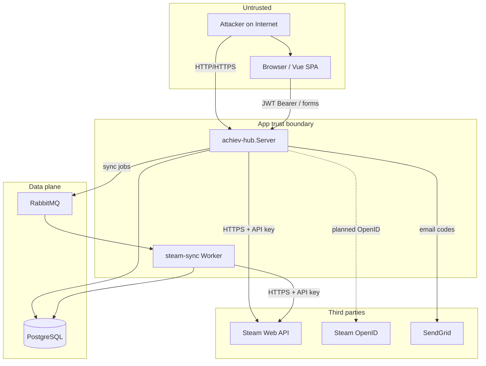

# SECURITY_THREAT_MODEL — AchievHub + SteamSync

**Date:** 2026-10-30  
**Scope:** `achiev-hub` (ASP.NET Core API + Vue SPA) and companion worker `steam-sync` (shared Postgres + RabbitMQ).  
**Auth model (as-built):** Steam ID + password → JWT Bearer; guest JWT without Steam proof. Steam OpenID 2.0 not implemented at audit start.  
**Canonical document:** this file in `achiev-hub`. `steam-sync` is treated as a trust-boundary component of the same system.

---

## 1. Attack surface inventory

### 1.1 HTTP — achiev-hub.Server

| Method | Path | Auth | Notes |
|--------|------|------|-------|
| POST | `/api/login` | anon | SteamId + password → JWT |
| POST | `/api/guest` | anon | JWT role `guest` for any SteamId string |
| POST | `/api/logout` | auth | Bumps `TokenVersion` (non-guest) |
| POST | `/api/register/validate-steam` | anon | Calls Steam `GetPlayerSummaries` |
| GET | `/api/register/status?steamId=` | anon | Sync/provisioning status |
| POST | `/api/register/send-verification` | anon | SendGrid email code |
| POST | `/api/register/confirm-code` | anon | |
| POST | `/api/register` | anon | Creates user + enqueues FirstSync |
| GET | `/api/steam/players/{steamId}` | auth | Steam profile proxy |
| GET | `/api/steam/games/recent` | auth | `steamId` query unbound |
| GET | `/api/steam/games/recent-achievements` | auth | Scoped to JWT user |
| GET | `/api/steam/games` | auth | Library; `steamId` query unbound |
| GET | `/api/steam/games/{appId}` | auth | |
| GET | `/api/steam/games/{appId}/achievements` | auth | |
| POST | `/api/steam/games/{appId}/sync-achievements` | auth (non-guest) | |
| POST | `/api/steam/games/sync` | auth (non-guest) | |
| GET | `/api/steam/sync/status` | auth (non-guest) | |
| * | `/api/goals…` | auth | Owner-scoped (good pattern) |
| * | `/api/users/stats…` | auth | JWT user |
| GET/POST/PUT/DELETE | `/api/users` | auth | **Unscoped CRUD** |
| GET/POST/PUT/DELETE | `/api/users-games` | auth | **Unscoped CRUD** |
| GET/POST/PUT/DELETE | `/api/users-achievements` | auth | **Unscoped CRUD** |
| GET/POST/PUT/DELETE | `/api/goal-achievements` | auth | **Unscoped CRUD** |
| GET/POST/PUT/DELETE | `/api/games` | auth | Catalog CRUD |
| GET/POST/PUT/DELETE | `/api/achievements` | auth | Catalog CRUD |
| GET | OpenAPI | Development only | `MapOpenApi()` |
| * | SPA static + fallback `/index.html` | public | Vue assets |

No public webhooks. No GraphQL. No `/actuator`/`/metrics` HTTP endpoints mapped.

### 1.2 Background / messaging — steam-sync

| Queue | Consumer | Trust model |
|-------|----------|-------------|
| `steam_sync_jobs` | `SteamSyncConsumer` | Broker trust; payload `UserId` + `SteamId` |
| `first_sync` | `FirstSyncConsumer` | Same |
| `games_list_sync` | `GamesListSyncConsumer` | Same |
| `user_achievements_sync_high/low` | Achievement consumers | Same |
| `sync_library` | `SyncLibraryConsumer` | Same |
| `global_achievement_update` | Global % consumer | AppId only |

**Cron / timers:** `DailyUpdateWorker` (NightlyCron), optional `GlobalPercentBackfillWorker` on startup.

**Publisher:** achiev-hub `SteamSyncClient` / topology initializer declares queues at API startup.

### 1.3 External integrations

| System | Direction | Credentials |
|--------|-----------|-------------|
| Steam OpenID (`steamcommunity.com/openid/login`) | — | **Not used** (pre-fix) |
| Steam Web API (`api.steampowered.com`) | outbound | Publisher Web API key |
| Steam Store (`store.steampowered.com/api`) | outbound | none |
| Steam CDNs (client images) | browser | none |
| SendGrid | outbound | API key |
| PostgreSQL | bi-dir | connection string |
| RabbitMQ | bi-dir | username/password |

---

## 2. Data-flow diagram (trust boundaries)

**Trust notes**

- Browser is untrusted; anything in JS/`localStorage` is attacker-reachable via XSS.
- RabbitMQ is a high-privilege channel: consumers write user libraries using payload IDs with no ownership check (pre-fix).
- Steam Web API key is equivalent to quota + access to public-profile endpoints for any SteamID64.
- Postgres holds password hashes and emails; worker has full schema access.

---

## 3. Asset inventory (personal / sensitive data)

| Asset | Stored where | Retention (as-built) | Who accesses |
|-------|--------------|----------------------|--------------|
| Email | `users.Email`, `email_verifications` | Indefinite until account delete | API, DB admins, SendGrid (transient) |
| Password hash (BCrypt) | `users.Password` | Same | API only (worker maps entity but does not auth) |
| SteamID64 | `users.SteamId`, JWT claim, jobs | Same | API, worker, Steam API calls |
| Role / Status / TokenVersion | DB + JWT | Same | API |
| Library / playtime / achievements | `users_games`, `users_achievements` | Same | API (owner + IDOR risk), worker |
| Goals | `goals`, `goal_achievements` | Same | API (owner-scoped for GoalsController) |
| Sync progress / LastError | `user_sync_status` | Same | API, worker; anon status by SteamId |
| Avatar / personaName | Not persisted; live from Steam | Ephemeral in API responses | Authenticated callers |
| IP address | Not stored in app DB | N/A (may appear in reverse-proxy logs) | Ops |
| JWT access token | Client `localStorage` (`achiev-hub-token`) | Until expiry (~30 min) or logout | Browser JS |
| Steam Web API key | Server config / env (also committed pre-fix) | Until rotated | API + worker processes |
| JWT signing key | Server config | Until rotated | API |
| SendGrid API key | Config / env | Until rotated | API |
| DB / RabbitMQ credentials | Config / compose | Until rotated | Hosts |

No CPF/government IDs. No payment data.

---

## 4. STRIDE (prioritized)

### Browser / SPA

| Threat | Priority | Notes |
|--------|----------|-------|
| XSS → token theft (I) | High | JWT in `localStorage` |
| CSRF on cookie-less Bearer | Low | State-changing APIs expect `Authorization` header |
| Open redirect post-login | N/A today | No OpenID return yet |

### API (achiev-hub.Server)

| Threat | Priority | Notes |
|--------|----------|-------|
| Spoofed Steam identity via guest / unbound steamId (S) | High | Guest JWT; Steam proxy query param |
| IDOR horizontal privilege (E) | Critical | Unscoped user/library CRUDs |
| Missing admin enforcement (E) | Medium | Seeded `admin` never checked |
| Credential stuffing / brute force (S) | Medium | No rate limit on `/api/login` |
| Steam API key abuse / quota DoS (D) | High | Authenticated caller drives arbitrary SteamId |
| Mass assignment of Role | Low | Role not on CreateUserRequest; still deletable via IDOR |
| Information disclosure (I) | Medium | Anon register status; UserDto emails on list-all |
| Tampering sync jobs if MQ exposed (T) | High | Trusts broker |

### PostgreSQL

| Threat | Priority | Notes |
|--------|----------|-------|
| Weak defaults / SSL off in local config (I) | Medium (dev) | `SSL Mode=Disable`, `postgres/postgres` |
| Backup exposure | Suspected | Ops-dependent; not in repo |

### RabbitMQ

| Threat | Priority | Notes |
|--------|----------|-------|
| Unauthenticated guest defaults (S/T) | Medium | Dangerous if broker internet-facing |
| Spoofed jobs attach wrong Steam library (T) | High | No UserId↔SteamId bind in worker |

### steam-sync Worker

| Threat | Priority | Notes |
|--------|----------|-------|
| Uses committed API key (I) | Critical | Same key as API |
| Writes PII tables with job trust (T/E) | High | |
| Rate-limit storms → Steam deny list (D) | Medium | Partial concurrency throttle only |

### Steam / SendGrid

| Threat | Priority | Notes |
|--------|----------|-------|
| Phishing if app asked Steam password | N/A | App uses local password, not Steam password |
| Email enumeration via verification | Low–Med | Timing/messages may differ |

---

## 5. Secrets map

| Secret | Intended location | Found at audit | Masked evidence |
|--------|-------------------|----------------|-----------------|
| Steam Web API key | User secrets / env `STEAM_API_KEY` / `SteamApi__ApiKey` | **Committed** in `achiev-hub.Server/appsettings.json`, `appsettings.Development.json`, `steam-sync/.../appsettings.json` | `5CFB****83B5` |
| JWT signing key | User secrets / env | Committed placeholder in hub appsettings | `AchievHubDevSecretKey_****` |
| Postgres password | Env / compose | Defaults in appsettings + compose | `postgres` |
| RabbitMQ | Env / compose | `guest`/`guest` in appsettings | `guest` |
| SendGrid | Env | Empty string in appsettings | `(empty)` |
| Seed passwords | Dev only | Hardcoded `achiev456` in `DbSeeder` | `achiev****` |

**Frontend env:** no `VITE_*` / `NEXT_PUBLIC_*` secrets.  
**CI:** no GitHub Actions workflows found.  
**`.gitignore`:** ignores `.env`, `appsettings.*.local.json`, `secrets.json` — does **not** ignore base `appsettings.json`.  
**Docker:** `docker-compose.yml` injects `STEAM_API_KEY` / `Jwt__Key` from env (good pattern) but tracked JSON still holds literals.

---

## 6. Assumptions and out-of-scope

- Production deployment topology (TLS termination, private RabbitMQ/Postgres networks) is not fully specified; threat model assumes any misconfiguration that exposes MQ/DB to the internet is catastrophic.
- Legal retention periods (LGPD) require product owner input.
- Steam OpenID will be added as a hybrid login (decision locked for remediation phase).
